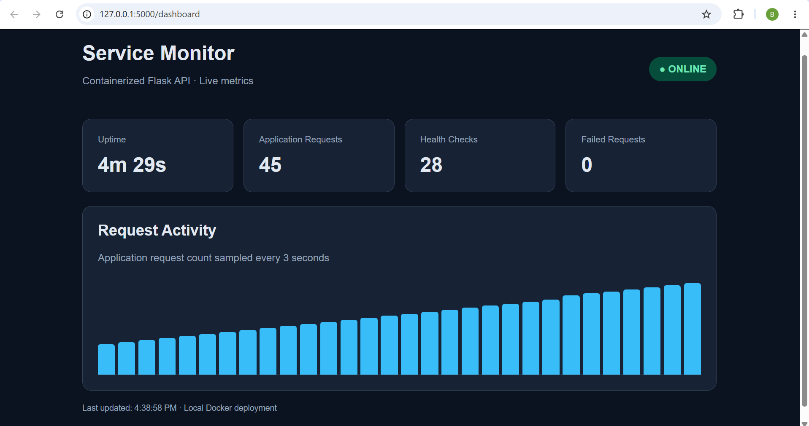

# Solace Service Monitor

**A containerized Flask API with health checks, structured logging, request metrics, and a live monitoring dashboard.**

## Project Overview

For Solace's Associate Platform Engineering take-home assignment, I built a lightweight Python Flask application and deployed it in a Docker container on my Windows computer.

I wanted to explore more than simply hosting a web page. My goal was to understand how applications are packaged, deployed, monitored, and troubleshot in a containerized environment.

The application provides HTTP endpoints, captures request metrics, produces structured JSON logs, and displays live information through a browser-based monitoring dashboard.



## Technology Stack

| Technology | Purpose |
|---|---|
| Python 3.12 | Application development |
| Flask 3.1 | HTTP API and dashboard hosting |
| Docker | Containerization and deployment |
| Docker Desktop / WSL2 | Local Linux container environment |
| HTML, CSS, JavaScript | Live monitoring dashboard |
| PowerShell / curl | Testing and troubleshooting |

## Architecture

The application runs inside a Linux Docker container. Docker publishes the application's internal port 5000 to port 5000 on the host computer.

**Browser / curl → localhost:5000 → Docker port mapping → Flask application**

Flask serves both the HTTP API and the monitoring dashboard. The dashboard polls the `/status` endpoint every three seconds to retrieve current application metrics.

The application also generates JSON-formatted request logs, which Docker captures and makes accessible through `docker logs`.

Docker separately runs an automatic health check against the `/health` endpoint every ten seconds.

## Features

### HTTP API

| Endpoint | Method | Description |
|---|---|---|
| `/` | GET | Application information |
| `/health` | GET | Basic application health |
| `/status` | GET | Uptime and request metrics |
| `/dashboard` | GET | Live monitoring interface |

### Monitoring Dashboard

The dashboard displays:

- Application uptime
- Number of non-health-check requests
- Number of health checks
- Failed HTTP requests (4xx and 5xx)
- A chart of sampled cumulative application requests
- The most recent dashboard update time

Metrics refresh automatically every three seconds.

### Health Monitoring

Docker periodically requests `/health` and uses the result to classify the container as starting, healthy, or unhealthy.

The health check helps distinguish between a running container and an application that can successfully respond to HTTP requests.

Docker's health check does not automatically restart an unhealthy container. Recovery would require additional configuration or an orchestration mechanism.

### Structured Logging

Completed HTTP requests generate JSON log entries containing:

- Timestamp
- Log level
- HTTP method
- Requested endpoint
- HTTP response status
- Request duration in milliseconds

This makes request activity easier to parse, filter, and investigate.

Flask's development server also generates its own plain-text access logs, so the complete log output is not exclusively JSON.

## Running the Project

### Prerequisites

Docker Desktop or another compatible Docker environment must be installed and running.

Python does not need to be installed separately on the host computer.

### 1. Build the Docker Image

From the project directory:

```bash
docker build -t solace-api .
```

### 2. Run the Container

```bash
docker run -d --name solace-container -p 127.0.0.1:5000:5000 solace-api
```

### 3. Access the Application

- Dashboard: http://127.0.0.1:5000/dashboard
- API: http://127.0.0.1:5000/
- Health: http://127.0.0.1:5000/health
- Metrics: http://127.0.0.1:5000/status

**Note:** These are local URLs. The application is not publicly hosted, so reviewers must run the container on their own computer.

### 4. Inspect Application Logs

```bash
docker logs --tail 20 solace-container
```

### 5. Check Container Health

```bash
docker ps
docker inspect --format '{{.State.Health.Status}}' solace-container
```

A correctly started application should eventually report `healthy`.

### 6. Stop and Restart

```bash
docker stop solace-container
docker start solace-container
```

To remove the container after stopping it:

```bash
docker rm solace-container
```

## Testing and Validation

I tested the application using PowerShell, curl, Docker CLI commands, and a web browser.

| Test | Observed result |
|---|---|
| Docker image build | Successfully completed |
| HTTP endpoint request | HTTP 200 OK |
| Health endpoint | Returned `{"status":"healthy"}` |
| Docker health monitoring | Reported `healthy` |
| Request counting | Increased after API requests |
| Automatic health checks | Generated repeated `/health` requests |
| Invalid endpoint | Returned HTTP 404 |
| Structured logging | Recorded request information and duration |
| Manual container restart | API responded successfully after restart |
| Monitoring dashboard | Displayed live metrics and updates |

### Troubleshooting Example

While implementing Docker health checks, my initial Dockerfile contained a syntax error, causing the image build to fail.

I discovered that Docker could still start a container from the previously built image, even though the latest build had failed.

Inspecting the container showed that no health-check configuration existed.

After correcting the Dockerfile syntax, rebuilding the image, and recreating the container, Docker successfully reported the application as `healthy`.

This reinforced the importance of checking build results and verifying that the running container actually contains the intended changes.

## Engineering Decisions

### Why Docker?

Docker packages the application with its runtime and dependencies, allowing it to run in a consistent environment across compatible systems.

Users do not need to manually install Python or Flask. This improves reproducibility and reduces differences between development environments.

### Why Local Hosting?

The assignment permits local deployments, and I chose this approach to focus on containerization, networking, and application monitoring without spending additional time setting up cloud resources.

The tradeoff is limited accessibility: the application is only reachable through the host computer's localhost interface.

### Why Flask?

Flask is lightweight and provides the functionality needed for a simple HTTP service without introducing unnecessary complexity.

It also allowed me to serve the monitoring dashboard and API from a single application.

### Why Publish Port 5000?

Docker containers have isolated network environments. I published port 5000 on the host computer to forward incoming HTTP requests to the Flask application inside the container.

I bound the published port to `127.0.0.1` to restrict access to the local host.

### Why JSON Logging?

Structured logs contain consistent fields that can be searched and filtered more easily than general text messages.

For example, a monitoring system could identify requests with server errors or unusually long durations.

### Why Include a Dashboard?

The dashboard provides a convenient way to inspect live application activity without manually executing commands for every metric.

It also demonstrates how a frontend can consume monitoring data provided by an HTTP API.

## Current Limitations

This project is intended as a local learning exercise, not a production-ready deployment.

- **Local-only hosting:** External users cannot access the service directly.
- **Development server:** Flask's built-in server is unsuitable for production deployment.
- **In-memory metrics:** Counters reset when the application restarts and are not aggregated across separate application processes.
- **Monitoring overhead:** Dashboard polling generates API requests that contribute to the request count.
- **Basic health checks:** The endpoint reports that the application can respond, but does not validate deeper dependencies.
- **Limited historical metrics:** The dashboard stores samples in browser memory rather than a persistent database.
- **No automatic unhealthy-container recovery:** Health-check failures do not themselves trigger a restart.
- **Limited security hardening:** Authentication, dependency pinning, non-root execution, and other production safeguards have not been fully implemented.

## Future Improvements

### Priority 1: Cloud Deployment

With additional time, my first improvement would be deploying the application to a cloud provider such as AWS.

This would allow reviewers and other users to access the service without running Docker locally.

I would explore a managed container-hosting service, configure the required networking, provide HTTPS, and investigate cloud-native logging and monitoring.

Docker makes this a natural next step because the application is already packaged as a container image.

### Priority 2: Reliability

I would replace Flask's development server with a production WSGI server, improve graceful shutdown behavior, and implement stronger health checks and recovery mechanisms.

### Priority 3: Observability

I would introduce persistent metrics, request-rate measurements, centralized logging, and alerting.

### Priority 4: Automated Deployment

I would add a CI/CD pipeline that automatically tests the application and builds its Docker image after code changes.

## What I Learned

The project helped me connect application development with infrastructure concepts.

I gained hands-on experience with container images, running containers, Docker networking, HTTP port publishing, health checks, application logging, and service monitoring.

One particularly useful lesson was understanding the difference between a running container and a healthy application, as well as recognizing that detecting a problem is not the same as automatically recovering from it.

Building and troubleshooting the application also reinforced the value of validating changes instead of assuming that a successful container startup means the latest configuration is deployed.

## Conclusion

This project gave me practical experience packaging, deploying, monitoring, and troubleshooting an application in Docker.

Although the implementation is intentionally small, it demonstrates several foundational platform engineering concepts and provides a starting point for future work in cloud deployment, reliability, and observability.
